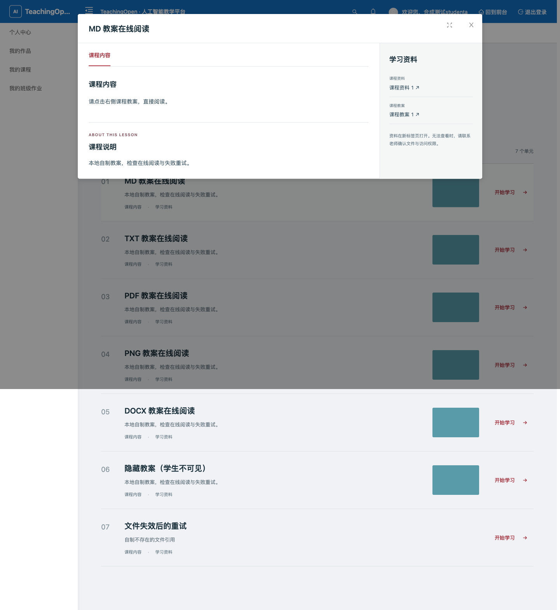
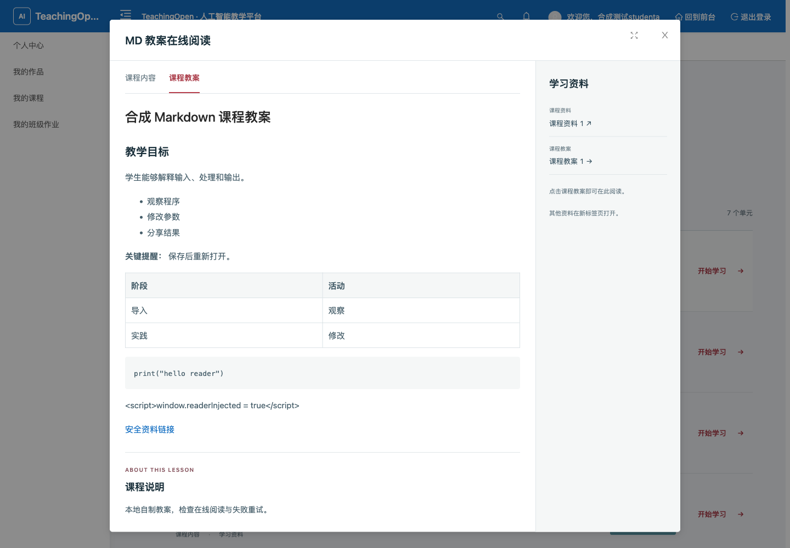
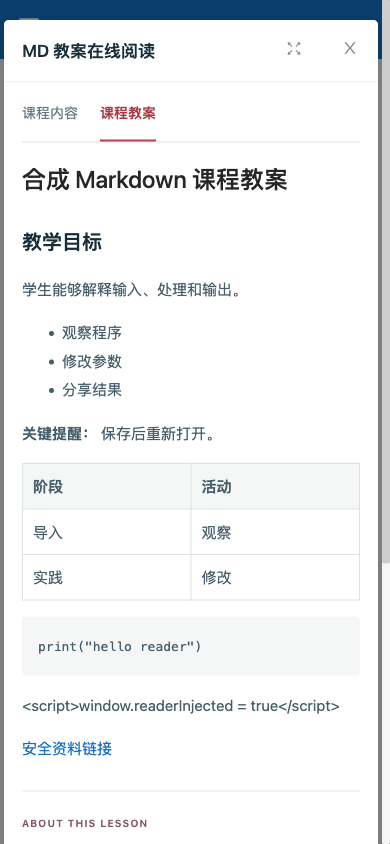
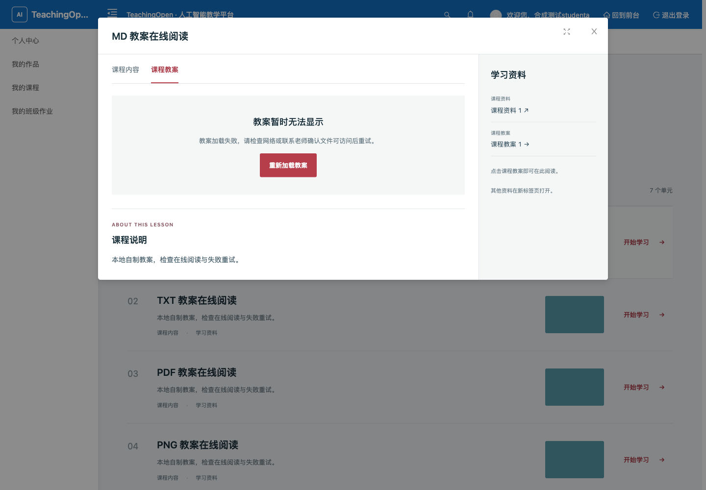

# 课程教案直接阅读验收（2026-10-15）

学生进入“我的课程 → 开始学习 → 课程教案”，在学习弹窗中看到排版后的正文，不再因点击教案而下载文件或跳转附件页。仅有教案的单元直接选中教案页签；有其他正文、视频的单元保留原先进入顺序。

## 原因与实现

旧版 `UnitViewModal` 没有教案阅读页签，教案通过新标签页附件链接打开。附件接口按现有策略返回下载响应，因此已有 Markdown 也会下载。基线浏览器点击同一份自制 `lesson.md`，实际收到下载事件；见 [原始记录](evidence/course-plan-inline/baseline-browser.log)。

增加页面内阅读器，使用原始附件地址和现有授权接口读取。Markdown 使用锁定的 `markdown-it@15.0.2`，关闭原始 HTML，再经过现有富文本净化；标题、列表、表格、代码可直接阅读。文本直接显示，PDF 与图片使用带正确类型的内存 Blob。多份教案可切换，关闭或切换取消旧请求、释放 Blob，并忽略过期响应。网络失败、权限失败、文件不存在、20 秒超时、空文件都有可见反馈；失败可重试，文件限制 10 MB。

Word 等不支持格式提示转换为 Markdown 或 PDF，不触发下载。本轮没有新增 Word 转换服务。经授权读取的 **2026-10-03 本地快照**中，83/83 份教案已经是 `.md`；该统计不代表当前生产全量。未来导入 Word 时可生成 Markdown 正文并保留原始文件，图片应导出为可访问资源，复杂版式可保留 PDF。

## 候选与验证范围

产品代码提交：`daeb31a9b49b6e9ecf33c758f46154c3be4c4a98`。基线：`abb2d01a106916cc1a29cbe2cd43bd0aff0433e9`。基线浏览器复用 `8db526ee` 构建，其 `web/`、`api/` 与基线提交无差异。后续证据提交只添加本文和验收资料，产品源码不变。构建目录摘要与后端 JAR 指纹见 [候选记录](evidence/course-plan-inline/candidate.json)。

全部运行发生在隔离合成环境：自制课程、师生和附件；完整 SPA 使用真实登录接口签发的登录态与媒体 Cookie，调用真实本地后端。没有连接或变更生产服务。

- 前端自动回归 **881/881**；其中教案读取、生命周期、学习弹窗与资料链接定向回归 **37/37**，包含超时、取消、过期响应、安全净化和教案切换。两项统计存在包含关系。
- 变更文件 lint、生产构建、依赖发布检查、首屏体积门禁通过。首屏资源 3,359,178 bytes，gzip 911,860 bytes，均在既有预算内。构建有既有 CSS、Browserslist 与资源大小提示。
- 真实 HTTP **79/79**：师生授权读取、未登录及跨班拒绝、GET/HEAD/Range、隐藏教案、Cookie 失效、真实 404；选定业务表与附件字节在断言期间保持一致。登录审计与用户认证元数据正常变化。见 [接口结果](evidence/course-plan-inline/http-access-result-corrected.json)。
- 完整浏览器 **18/18**：1440×1000 和 390×844 阅读 Markdown，表格/列表/代码显示，原始脚本未执行，切换单元清除旧内容，真实读取 TXT/PDF/PNG，Word 格式提示，学生不可见教案不暴露，真实 404，故意中断一次文件请求后成功重试。过程中 **0 次下载、0 个新标签页**。PDF 检查覆盖 iframe 使用 PDF Blob，不代表逐页视觉审核。见 [浏览器结果](evidence/course-plan-inline/browser-result.json) 和 [场景脚本](evidence/course-plan-inline/check-reader.cjs)。
- 未参与产品实现的 Agent 完成独立技术复核，未发现本轮阻塞；另行执行 37 项定向回归与 79 项 HTTP 检查。见 [复核记录](evidence/course-plan-inline/independent-review.json)。
- 产品代码提交的 [CI 运行](https://github.com/ZZZZihan/TeachingOpen/actions/runs/38736276752) 中，前端测试与构建、后端与 MySQL 注册验证、备份迁移工具及 required 汇总均通过。PR 最新证据提交的状态以 PR 检查栏为准。

初始 HTTP 探针有 1 项夹具预期错误：现有拒绝课程列表接口返回 HTTP 200、`success=false/code=510/result=null`，探针曾预期 403；对照现有契约修正后 79 项通过，初始失败保留在本地证据目录。初始浏览器脚本在切换屏幕宽度及导航初始化后遇到弹窗消失；调整为先固定宽度、导航并等待加载稳定再打开，保留原断言后通过。独立源码诊断确认旧布局在跨 1087.99px 断点时存在重建课程页并关闭弹窗的路径，本次未修改；原始失败没有生命周期轨迹，准确触发尚未定位，也不能归因于全页截图。固定宽度阅读验证不覆盖跨断点保留弹窗。截图关闭动画以捕获最终显示状态。本地严格 CSP 对既有外部错误上报和插图有拦截提示，不影响本轮附件读取。

## 视觉证据

修改前，1440×1000 视窗（全页截图）：

修改后，1440×1000：

修改后，390×844：

网络失败提示及重试入口，1440×1000：

本次由主 Agent 实现与整合，两个子 Agent 分别负责根因调查及回归、独立技术复核及真实权限验证。子 Agent 均显式请求 GPT-6.1 Sol / ultra；请求参数不作为实际运行配置的独立核验。合并、生产部署、生产文件转换和用户人工验收不包含在上述结果中。
