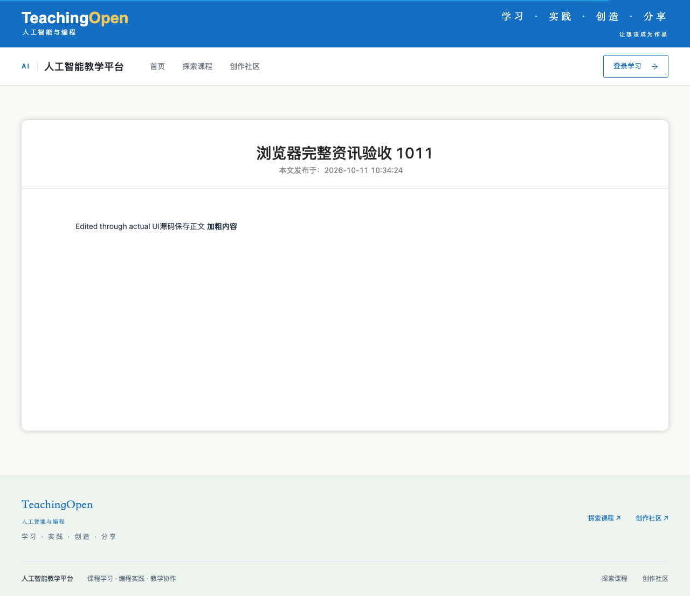
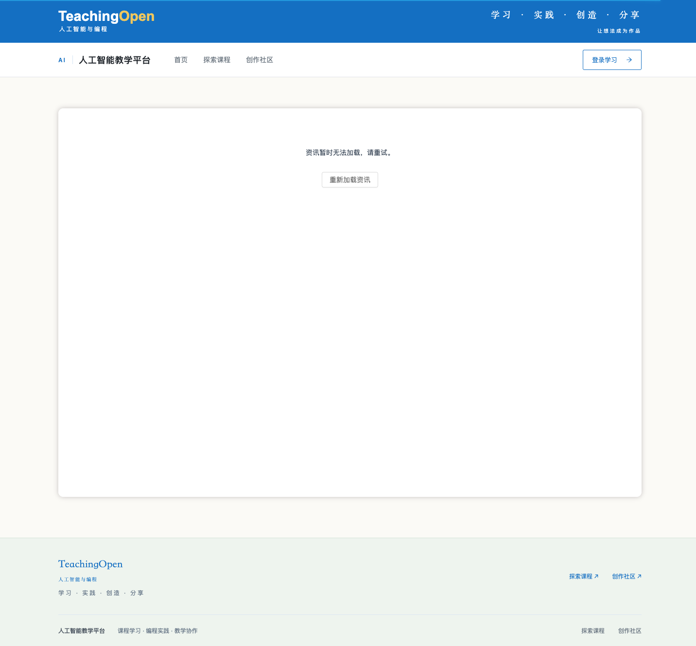

# 资讯详情状态验收

修复前截图来自 main@fed2e3b096d983b96d327ac5cdbe9417a60696e2：通过应用路由切到不存在的记录，真实接口失败后仍保留上一篇标题与正文。视口 1280×720，截图覆盖完整页面。

修复后完整生产 SPA，视口 1440×1000：失败清空旧正文并显示重试按钮；重试请求当前 ID，返回有效记录恢复，缺少 ID 显示空状态。

[逐项浏览器结果](browser-results.json)：22/22，包含实际编辑、剪贴板粘贴、源码编辑、图片上传、保存重开、跨记录撤销隔离以及匿名正文/图片读取。乱序场景仅延迟真实后端响应的交付，没有构造返回数据；旧成功响应不能覆盖新的失败记录。截图内容均为合成夹具。

本页证据来自四项相关修复的本地整合版本 516dd6e3；单元访问统计独立复核期间尚未纳入此轮浏览器运行。最终整合验证另见 PR 描述。不是生产部署或人工验收。
