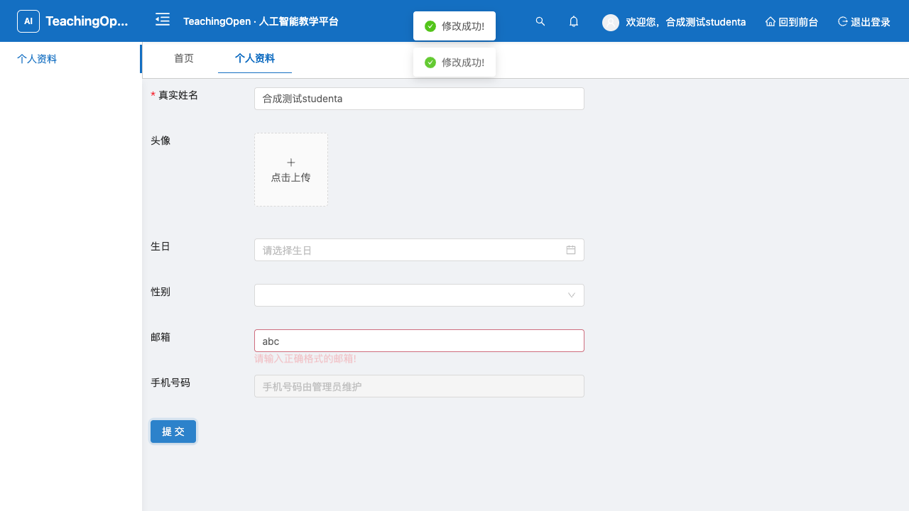
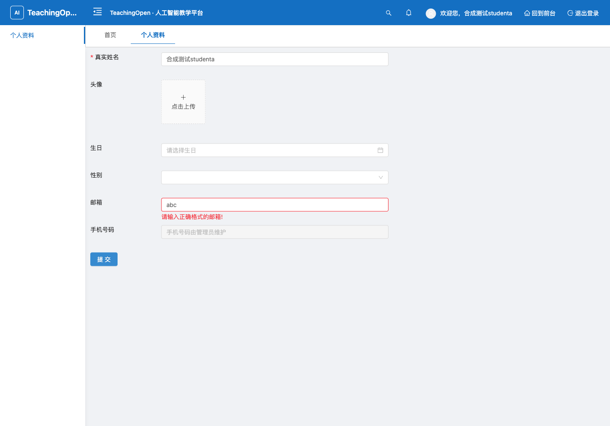

# 个人资料邮箱校验验收

修复前截图来自 main@fed2e3b096d983b96d327ac5cdbe9417a60696e2：完整表单提示邮箱错误，点击提交仍显示成功并把 abc 保存到 MySQL。视口 1280×720。

修复后完整生产 SPA，视口 1440×1000：点击提交仍显示格式错误，没有发出 PUT 保存请求，数据库保留此前合法邮箱。合法邮箱和可选空邮箱均真实保存成功。

[逐项浏览器结果](browser-results.json)：10/10。真实 Axios、用户资料接口、MySQL、Redis；没有替换组件或模拟保存响应。截图中的账户均为合成夹具。

本页证据来自四项相关修复的本地整合版本 516dd6e3；单元访问统计独立复核期间尚未纳入此轮浏览器运行。最终整合验证另见 PR 描述。不是生产部署或人工验收。
