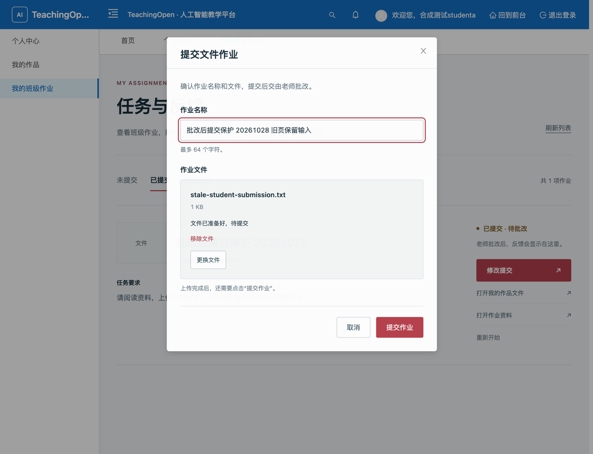
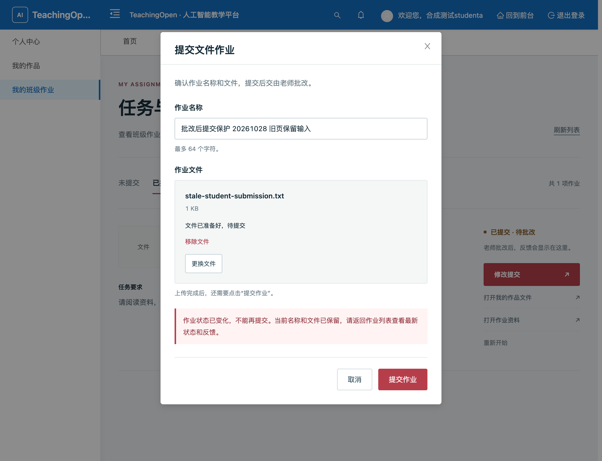
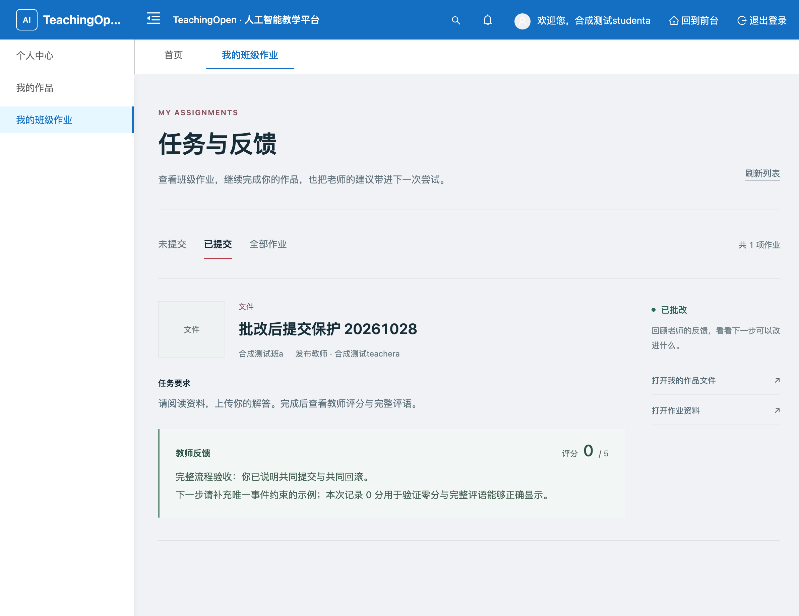
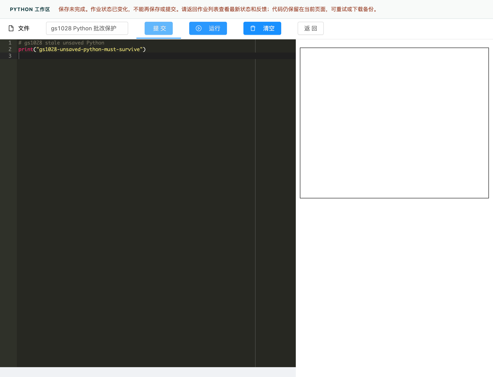
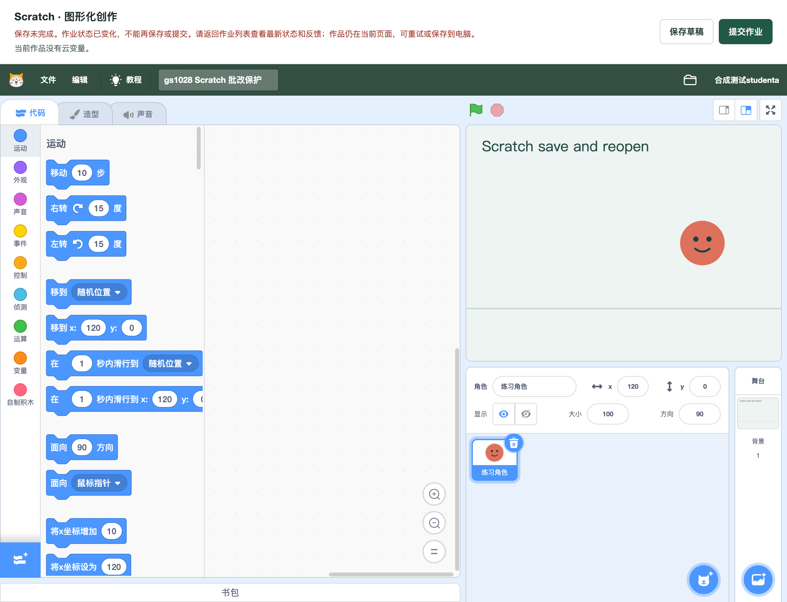
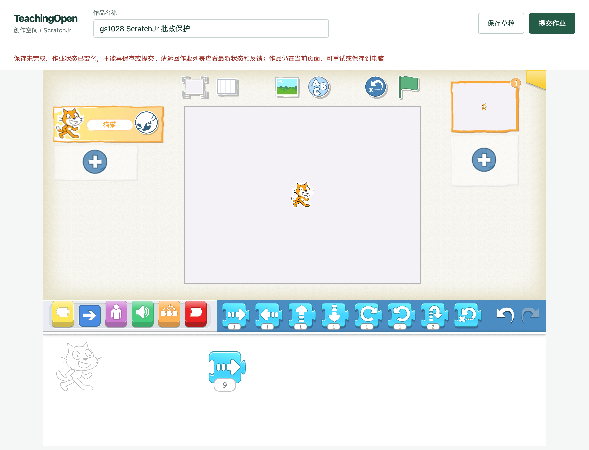
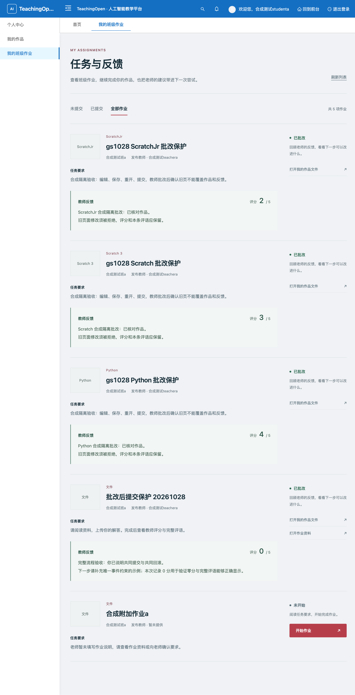

# 阻止旧页面覆盖已批改作业

学生在教师批改前打开编辑器或文件提交弹窗，教师批改后再点击保存/提交，旧实现会覆盖原文件并把状态改回草稿或待批改，评分与评语却仍指向旧内容。本轮让同一作品的已批改、公开、精选状态在服务端拒绝学生后续保存/提交，保留原文件及教师反馈；合法草稿、待批改修改和初次提交继续工作。

## 实现与验收边界

- 学生提交事务按既有顺序锁用户和作品，再检查数据库当前状态。仅 `0/1` 可改写；`2/3/4`、空值和未知状态在历史、附件引用、作品与统计写入前拒绝。覆盖显式作品 ID 与无 ID 回查旧提交。
- 使用既有响应格式 `HTTP 200 / success=false / code=409`。文件弹窗和 Python、Scratch、ScratchJr 显示固定状态提示，保留输入与未保存内容；不展示后端任意错误细节。
- 教师先批改时，等待锁的旧提交读取最新状态并拒绝；学生合法修改先提交时，教师随后批改最新文件。未新增锁顺序、数据库迁移或重交审批功能。
- 编辑器原有流程会先上传、登记项目及封面，再调用提交接口。被拒绝的提交不覆盖作品或反馈，但此前独立上传可能留下未引用文件；不能把整个按钮动作描述为文件系统零写入。

## 候选与本地验证

基线为 `369c981e032705b10e031778f0cffc3ad33e264f`，修复源码与本报告同分支提交。所有写入及故障测试均在本机回环地址、五个合成账号、独立 MySQL/Redis 中进行，未连接生产数据。Java 8 后端与生产构建的完整 SPA 使用同一候选：

- JAR SHA-256：`1516bbfcbd70731c988a1c9aaa21a539dfa0e38ce403c19b7c553aa576b8161f`。
- dist 清单 SHA-256：`36f3867c1768d71df09bbe4be739776f258958291070f857fe4753d868db3438`。
- HTTP/SQL probe SHA-256：`11c3efd713b4dddd329935148c6a607030ad57349a4b109015106c103b2840d2`。

40 套必需 Java 测试共 **383** 项通过；前端测试 **885** 项通过，包含四入口409输入保留；CI 工具单元测试 **149** 项通过。前端生产构建、改动文件 lint、文件弹窗 lint、首屏资源预算和差异检查通过。数字与范围见 [local-checks.json](evidence/graded-work-submission-20261028/local-checks.json) 和 [Java 报告](evidence/graded-work-submission-20261028/java-tests.json)。远端 CI 以 PR 当前检查状态为准。

真实 HTTP/MySQL 使用同一份 probe 做红绿对照：旧版 **139/219**，修复版 **219/219**。新增36组合覆盖 `2/3/4 × 课程/班级/个人作品 × 有ID/无ID × 草稿/提交`，每次独立数据并核对拒绝后作品、反馈、历史、统计、文件字节、缓存和媒体引用。四个双向竞态通过真实触发器与数据库锁等待控制先后，保留正常初交、并发重试、故障回滚。全部原业务、文件、媒体引用、缓存和临时触发器恢复检查通过；正常认证审计日志保留。[旧版报告](evidence/graded-work-submission-20261028/baseline-submission-v2.json) · [修复报告](evidence/graded-work-submission-20261028/fixed-submission.json)

首次远端 CI 中上述提交探针也为219/219；附件授权旧探针随后暴露流程顺序冲突：先把教师发送的副本批改成状态2，再期待学生保存回草稿0。已保留全部原权限/附件断言，将合法学生草稿保存移到批改之前，批改后新增409及业务、文件、统计、媒体引用保持检查。同步后的完整探针在同一修复JAR下 **77/77** 通过，原始数据恢复检查通过；独立复核确认没有放松产品规则或删除原断言。[附件引用完整报告](evidence/graded-work-submission-20261028/reference-fixed.json)

## 文件作业完整浏览器流程

在完整 SPA 中通过真实用户名、密码、验证码登录，使用可见控件依次执行，浏览器为 headed Chrome，桌面窗口内容为1200×919 CSS px、DPR 2：

1. 教师发布班级文件作业、上传资料；模拟发送前网络失败保留输入，重试只创建一条，重开内容一致。
2. 学生实际打开并下载资料、上传解答；模拟提交失败保留名称和文件，重试后显示待批改，数据库只计一次提交。
3. 学生保持批改前打开的旧弹窗，准备替换文件与新名称。
4. 教师实际预览、下载学生文件，录入0分和多行评语；保存失败保留输入，重试成功，重新打开评分与评语一致，提交/批改各计一次。
5. 学生在原旧弹窗点击提交，实际响应为业务409；名称、文件与弹窗保留，整个提交请求前后的夹具可见业务字段、文件登记、历史、统计、媒体引用摘要一致（完整存储检查另见HTTP/SQL报告）。
6. 学生刷新后看到已批改、0分和完整多行评语，无修改入口；读取失败、重试和整页重开仍正确。

资料与学生作品均通过真实界面点击下载，落地字节与上传原件完全一致。结构化结果见 [file-browser-flow.json](evidence/graded-work-submission-20261028/file-browser-flow.json)。三个编程编辑器的真实页面验收另列于下文。

以下两张为同一旧弹窗在本轮修复候选上的操作前后，**不是旧版本与新版本的界面比较**。

批改前保留旧页面及未提交输入：

批改后再次提交被拒绝，输入保留：

学生整页重开后的反馈：

## 三个编辑器完整浏览器流程

同一产品源码 `37609afb`、相同JAR/dist另用独立师生会话完成真实页面布置、编辑、保存重开、提交、教师批改、旧页拒绝及学生反馈。后续源码提交仅同步上述授权探针和证据，产品代码未改变。

| 编辑器 | 实际保存/重开/提交 | 批改后旧页保留的未保存内容 | 学生重载后的反馈 |
| --- | --- | --- | --- |
| Python | 键盘输入源码后提交，关闭并重开后逐字一致；该页面无独立草稿按钮 | 新输入的Python源码 | 4分及完整双行评语 |
| Scratch | x=100保存草稿，重开仍100，再以x=-80提交同一作品 | x=120 | 3分及完整双行评语 |
| ScratchJr | 实际选择猫猫、拖入前进积木，5步保存草稿/重开，再以8步提交 | 前进9步 | 2分及完整双行评语 |

三页实际点击提交均收到业务409，明确提示状态变化，控件恢复可用。提交请求前（预上传后）与拒绝后的夹具可见SQL状态一致，原作品及反馈/历史/统计/媒体引用保持；独立读盘确认原项目和封面哈希一致。预上传新增记录分别为1/2/2，已按既有流程记录。随后三个页面分别实际reload，观察到浏览器原生离页提醒并取消，未保存内容仍在。教师重新打开三份批改弹窗，学生刷新及整页重载，反馈全文和分数一致，已批改卡片无编辑入口。[结构化编辑器结果](evidence/graded-work-submission-20261028/editor-browser-flow.json)

补充390×844桌面Chromium移动视口读取文件作业：关闭导航抽屉并选择已提交后，0分及完整评语无遮挡、卡片无横向溢出、无编辑入口；未作为真实手机或编辑器移动端验收。[完整反馈卡片](evidence/graded-work-submission-20261028/file-feedback-mobile-390-card.png)

本轮两套隔离服务已定向停止，浏览器fixture的17张业务表、20个新上传文件及所选业务/UI缓存均恢复，正常审计日志保留；数据库目录、配置、日志和原始证据保留。[浏览器恢复报告](evidence/graded-work-submission-20261028/browser-cleanup.json)

## 复核与交付限制

未参与产品实现的 Agent 独立检查锁顺序、合法调用方、拒绝副作用、409四入口和红绿证据，未发现本轮阻塞。主 Agent 实际执行文件链与证据核对。本地构建第一次遇 controller 泛型返回类型编译错误，修正后干净构建和全部必需套件通过；probe第一次夹具后缀冲突已修正并保留原失败，再用同一最终probe完整红绿重跑，没有删除断言。

编辑器辅助脚本中出现过隐藏节点重名、误匹配上一列表响应、只读Vue宿主定位和未刷新缓存列表的失败；先核对实际状态，再从未完成处继续，原失败保留，没有重复创建或重写已落库的批改。最终教师三弹窗重开、学生刷新和重载、三旧页拒绝均独立成功。ScratchJr一份中间只读截图遇到页面重挂载，其原因未在本轮定论，最终重新打开验证通过，不以中间失败截图代替验收。浏览器原始日志和独立一致性复核保留在本轮本地成果目录。

本报告不代表已合并、已部署或人工验收。首次远端前端发布检查因既有Swiper/lodash.pick例外于2026-10-24到期而拒绝；策略、依赖和锁文件与基线无改动，没有为本轮续期或绕过门禁，后续远端状态以PR检查为准。使用旧缓存编辑器仍由服务端阻止覆盖，但旧前端可能显示通用失败提示；明确的新提示需要对应前端资源。复杂积木执行、生产配置、容量和真机不属于本轮验收。
