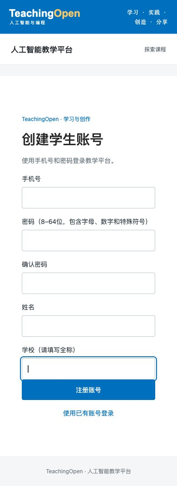
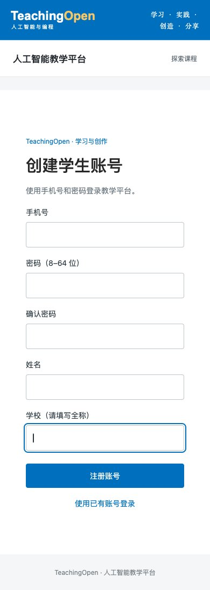

# 注册页间距与密码规则

本轮结果：学生和教师注册页的最后一个学校输入框与提交按钮分开显示；注册密码接受 8–64 位非空白可打印 ASCII，不再要求同时包含字母、数字和特殊符号。注册身份、基础角色、资料字段和找回密码／管理员密码策略保持原有行为。

产品提交：`47ee8fbc8133c1c0d38c23c46148698e5403dd5e`，基线 `fc626aa4f0b68c0543ff9ae19e9c45284f34be4f`。本记录及截图为该产品提交的补充证据，不代表生产部署或人工验收。

## 实现与验收

原页面只有字段上边距，按钮没有上边距；实际线上学校输入框到按钮间隔为 0px。现在按钮使用块级布局并明确留出 24px 上边距。两入口共用同一注册组件，密码使用注册专用前端与后端规则，保留与现有加密实现兼容的字符范围。

| 场景 | 390 × 844 CSS 视口 | 1440 × 1000 CSS 视口 |
| --- | --- | --- |
| 修改前学生页学校输入框到按钮 | 0px | 0px |
| 学生页学校输入框获得焦点 | 24px | 24px |
| 教师页学校输入框获得焦点 | 24px | 24px |
| 学校必填错误出现后 | 输入框到按钮 53px；提示所在字段到按钮 24px | 输入框到按钮 53px；提示所在字段到按钮 24px |

上述最终视口没有横向溢出。原浏览器站点缩放影响了首个视口请求，最终采用开发用设备尺寸接口并读回实际 CSS 尺寸；保留初始观测及修正记录，验证后恢复所有尺寸覆盖。见 [布局观测](evidence/registration-form-usability-20261013/layout-observations.json)。

## 验证范围

- 前端全量测试 859/859；本次修改文件 ESLint、项目 `lint:changed`、生产构建及初始资源预算通过。构建仍有图表 CSS 顺序、资源体积与入口体积三类警告，不声称零警告构建。
- Java 8 干净构建，40 组必需核心测试 374/374，零失败或跳过；其中注册 10/10、密码找回 24/24。见 [Java 结果](evidence/registration-form-usability-20261013/java-tests.json)。
- 最终 JAR 在独立 MySQL／Redis 环境执行 115/115 项真实 HTTP／SQL 检查。覆盖纯数字 8 位、纯字母 8 位、纯字母 64 位注册与密码登录；7 位、65 位、空密码、空格、控制字符、中文拒绝，并逐次核对 10 张表摘要。既有身份伪造、注册关闭、跨入口重复、并发、事务回滚和管理权限拒绝检查继续执行。见 [接口结果](evidence/registration-form-usability-20261013/http-registration.json)。
- 完整 SPA 分别提交学生和教师注册并显示成功页，再进入登录页。学生页先用已注册教师手机号触发真实重复错误，输入保持在表单，只修改手机号后重试成功。实际注册的持久化资料、角色及同一密码登录再由 API／SQL 核验；浏览器没有提交登录验证码，不把 API 登录称为浏览器完整登录。
- 独立 Agent 复核未发现本轮阻断问题，另执行 52/52 项注册、找回、登录相关前端检查，以及字符边界和双入口网络失败后保留输入、恢复按钮、重试成功的组件检查。
- CI 隔离保护 19/19。一次使用不存在的测试文件名只发现 0 项测试，随后更正为实际 `ci/test_ci_guards.py` 后执行上述 19 项，不将空运行视为通过。

后端初始化曾因默认夹具执行时构建输出尚未就绪而失败；保留原始记录，随后沿用项目注册验收方式建立全新 `teachingopen_check_registration_form` 库和独立 Redis DB3。未覆盖旧环境，未连接生产数据库。运行目录及私有原始日志保留在本机 `.devspace/reg-form-1013`。

源码文件摘要、前端产物清单摘要和 JAR 摘要见 [候选绑定](evidence/registration-form-usability-20261013/candidate.json)。密码、令牌、运行配置及私有原始应用日志不提交。

[浏览器注册后核验](evidence/registration-form-usability-20261013/browser-registration.json)确认两账户姓名、学校、固定资料身份及基础学生角色正确，学生重试仅创建一个账户，两账户使用页面设置的密码真实登录成功。[清理记录](evidence/registration-form-usability-20261013/cleanup.json)确认本轮 7 个测试账户及关系清除、Redis DB3 归零，保留 9 条正常认证审计；后端、MySQL、Redis和前端四个任务端口均已关闭。初次清理的 ID 格式防护在任何删除前拒绝了实际的数字型主键，核对本轮手机号归属及实际主键格式后才完成清理；该夹具问题不作为产品缺陷或第一次清理成功处理。

## 页面证据

修改前手机视口：

修改后手机视口，学校字段获得焦点：

其他视图：[桌面学生](evidence/registration-form-usability-20261013/after-student-1440.jpg)、[手机教师](evidence/registration-form-usability-20261013/after-teacher-390.jpg)、[桌面教师](evidence/registration-form-usability-20261013/after-teacher-1440.jpg)、[必填错误](evidence/registration-form-usability-20261013/after-student-390-errors.jpg)、[接口拒绝](evidence/registration-form-usability-20261013/after-student-390-api-error.jpg)、[学生注册成功](evidence/registration-form-usability-20261013/student-registration-success.jpg)、[教师注册成功](evidence/registration-form-usability-20261013/teacher-registration-success.jpg)。
