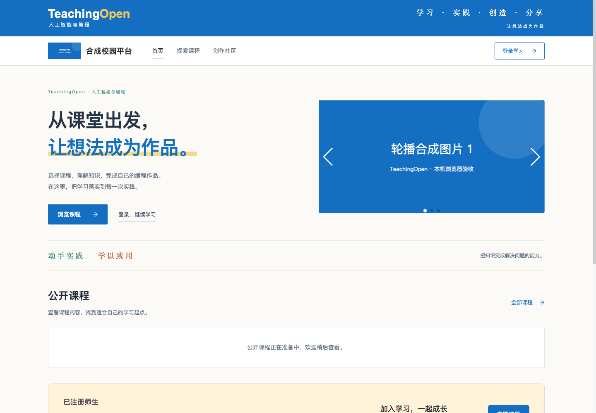
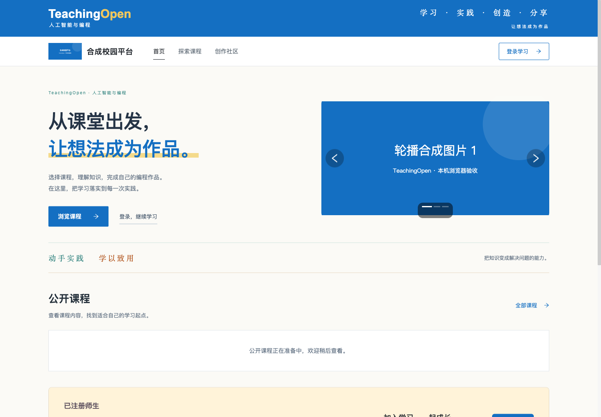

# 浏览器依赖发布检查修复

原依赖例外在 2026-10-24 到期，使 PR #151 在依赖发布检查处失败。本次以 main `369c981e` 为基线独立修复依赖；作业提交修复仍在其自身 PR 中。本次没有延长例外、关闭检查或修改严重性标准，也没有合并主分支、部署或生产写入。

## 最终改动

- 首页轮播复用项目已有的 Ant Design Vue Carousel，移除 Swiper 和 Vue Awesome Swiper。保留图片及链接顺序、前后切换、分页、循环、5 秒自动轮播及鼠标/触控拖动；动画由 coverflow 改为横向滚动。单图隐藏无效控件，无图保持原首页插画。局部深色分页底提高浅色背景上的可见性。
- 43 个表单组件、3 个验证入口和 16 个代码生成模板改用 `lodash/pick`，直接锁定项目原已有的 `lodash@4.18.1`。审查全部 54 个源码调用、168 个平坦字面量字段，保持缺失字段、继承属性、空值和数组/对象引用语义。旧 `lodash.pick` 无修复版本，已从锁文件移除。
- 移除到期例外后，当前 npm 公告又命中 DOMPurify 和 markdown-it，分别补丁升级到 `3.4.17` 和 `15.0.3`。Markdown 的多行引用耗时问题在项目 `html:false` 配置下仍可达；DOMPurify 公告要求的 DOM 返回/原位修改配置未在项目开启，但仍更新受影响包。净化选项、后端 jsoup 规则和业务接口未改动。
- 锁文件只删除 6 个不再需要的包路径，更新 DOMPurify、markdown-it 及其所需 argparse 补丁，没有其他包版本漂移。例外列表清空；依赖检查程序、实际产物清单插件、CI 工作流和首屏预算保持原样。

## 本地验证

在新工作树独立安装依赖，没有修改旧工作树共享的 node_modules。本机 Node `26.12.1`，安装及公告核查使用 npm `11.19.0`；远端使用仓库固定的 Node/npm，结果以 PR 检查为准。

- 完整前端测试 **886/886**，CI 工具单元测试 **150/150**；改动的启动文件与轮播 lint、差异检查通过。
- 生产构建、首屏资源预算和原依赖门禁通过：编辑器依赖图与实际浏览器模块合计 **117** 个包，**0** 条例外。实际浏览器清单 109 个包，锁文件摘要一致；不含 Swiper、Vue Awesome Swiper、lodash.pick。
- 新表单兼容回归从实际源码提取字段，覆盖合法取值及原型污染路径拒绝。新教案回归使用产品同一 Markdown 浏览器 UMD 构建和实际加载函数，覆盖合法多行引用和异常长引用；读取响应及净化调用为合成测试边界。
- 相同约 800 KB 输入：旧 markdown-it `15.0.2` 的未闭合标题和标签分别在 5 秒上限终止；新 `15.0.3` 分别约 602 ms 和 516 ms 完成，正文及净化调用保留。原始 400 KB 观察和最终 800 KB 结果分别留存，没有通过删断言获得通过。
- 更新后的 DOMPurify 在真实 Chromium 通知组件中保留合法段落、加粗、表格和图片，并去除脚本、事件属性及危险链接。编辑器、公开资讯和轮播的浏览器范围另见下文及 PR 附加验收记录。

最终生产构建文件清单 SHA-256：`b371f024126da26ea754734abe942edd45cd7609917330bde239de86eeb6c39d`；锁文件 SHA-256：`fe1366e57692fc71537e41caba975b7566504ca170faddc4057a42488dd92e40`。完整原始日志和逐文件摘要保留在项目 `.devspace/artifacts/runtime-dependency-expiry-20261029/`。

## 浏览器与技术复核

使用完整生产 SPA、本机合成接口和真实 Chromium，验证桌面 1440×1000 与移动视口 390×1000。最终构建轮播检查 **31/31** 通过，包括无图、单图、多图、分页、按钮、5 秒自动切换、交互后继续播放、鼠标拖动、触控、新标签链接和连续三轮离页/重访，以及修正后的分页对比度和点击。此环境未连接 MySQL，不代表实体手机或生产验收。

[浏览器结果与产物绑定](evidence/runtime-dependency-expiry-20261029/browser-results.json) · [依赖门禁](evidence/runtime-dependency-expiry-20261029/dependency-gate.json) · [Markdown 红绿结果](evidence/runtime-dependency-expiry-20261029/markdown-reference-red-green.json) · [首屏预算](evidence/runtime-dependency-expiry-20261029/initial-assets.json)

桌面轮播更新前后（1440 CSS px）：

移动视口更新前后（390 CSS px；旧图 DPR 3，新图按 CSS 像素导出）：

独立 Agent 复核表单调用语义、代码生成模板、包和锁文件范围、门禁不被放宽、新回归有效性及实际构建哈希。曾发现新增 Markdown 测试直接导入内部路径被 Node exports 拒绝，已改用官方 `markdown-it/browser` 导出并重新通过。首次去除例外后的新漏洞审计失败与修复后通过记录均保留。

上游轮播离页时未显式调用 ResizeObserver 的 disconnect/unobserve；有限的三轮导航、resize 和离页等待中，旧实例销毁且未观察到持续回调、自动切换或界面异常。这不是长期内存测试。原页面既有 errlog 外联在浏览器夹具中被阻止，预期网络错误与产品未捕获 JavaScript 异常分别记录。

依赖门禁通过只代表其声明的编辑器与实际浏览器运行范围，不代表整个工具链 npm audit 清零。真实接口/数据库、完整远端 CI、主分支合并、部署及人工验收各自保留状态，不能以本地测试替代。

## 上游依据

- [Swiper 公告](https://github.com/advisories/GHSA-p3hc-fv2j-rp68)
- [lodash.pick 无修复版本公告](https://github.com/advisories/GHSA-p6mc-m468-83gw)
- [DOMPurify 3.4.17 发布说明](https://github.com/cure53/DOMPurify/releases/tag/3.4.17)
- [Markdown 引用耗时公告](https://github.com/markdown-it/markdown-it/security/advisories/GHSA-gfr2-rv44-r23c)
- [markdown-it 15.0.3 发布说明](https://github.com/markdown-it/markdown-it/releases/tag/15.0.3)
