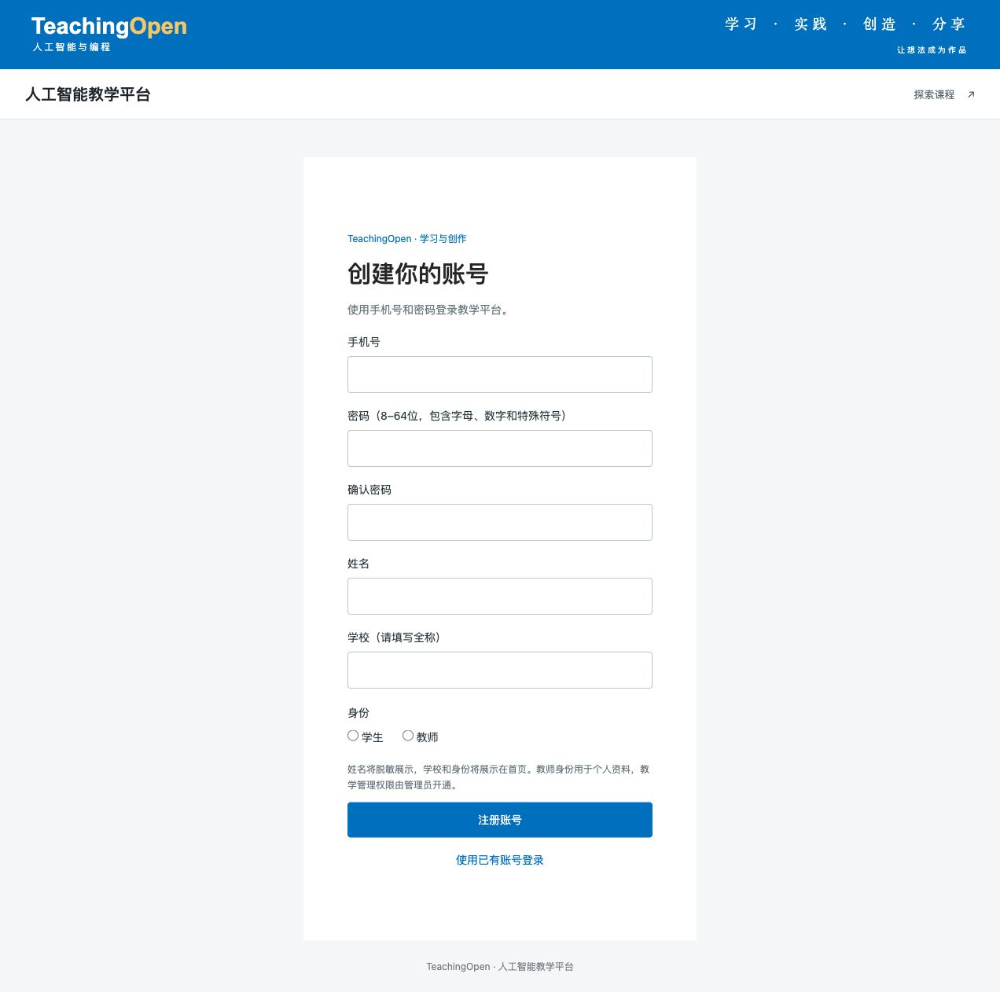
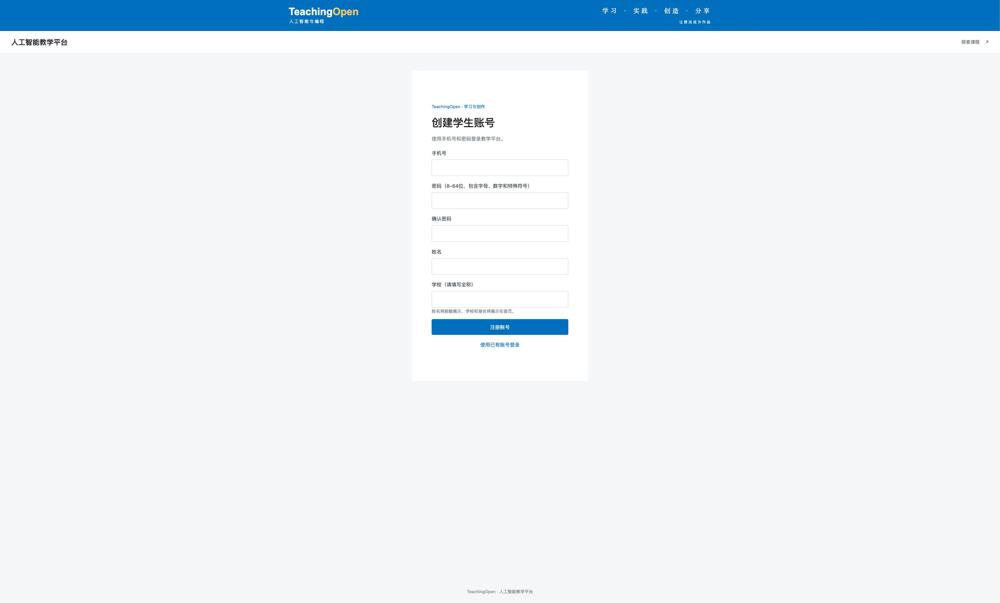
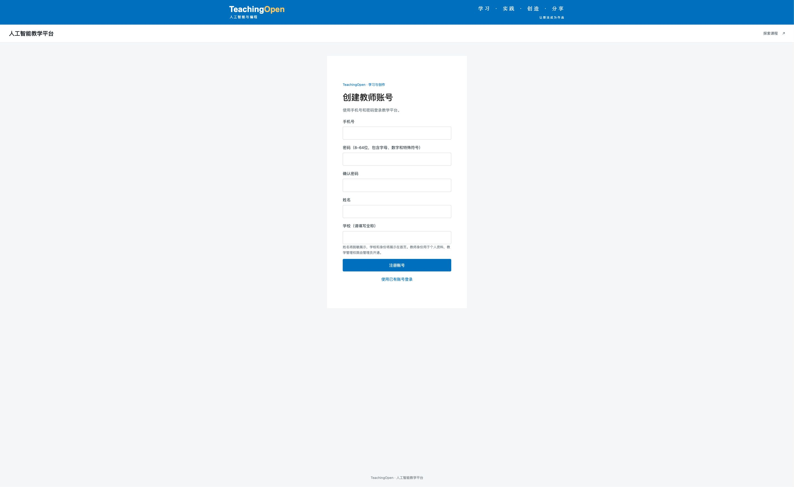

# 公开注册默认学生，教师使用独立入口

验收日期：2026-10-11。代码基线：`2cbd9c4713a6a7ec830fd6c5b30a02a2a98aface`。本记录是候选版本在本地隔离环境的验收，不代表已合并、部署或通过线上验收。

## 最终行为与入口

| 页面 | 注册接口（相对 `/api`） | 资料身份 | 自动授予的角色 |
| --- | --- | --- | --- |
| `/user/register` | `POST /sys/user/register` | 学生 | `student` |
| `/user/teacher-register` | `POST /sys/user/register/teacher` | 教师 | `student` |

普通注册页显示“创建学生账号”，不再展示身份选择或教师说明。首页及登录页的注册链接仍只进入普通注册页。教师页面通过独立链接访问，页面说明教学管理权限由管理员开通。

后端按接口固定资料身份，不采用请求中的 `identity` 或角色字段。两个入口共用注册开关、字段校验、重复检查和事务。旧页面即使向普通接口提交 `identity=teacher`，也只会创建学生资料。前后端应一起交付；无需新增数据库迁移，已有账号资料不变。独立链接没有邀请或保密限制，权限安全由后端的固定学生角色保证。

## 已执行的验证

- 前端全量测试 **806/806**；生产构建、初始资源大小检查和本次修改文件的 ESLint 检查通过。
- Java 8 干净构建与 19 组核心测试 **170/170**，零失败、错误或跳过；其中注册服务 **8/8**。Surefire 完整性检查通过。
- CI 隔离保护测试 **13/13**，两个 Python 脚本语法检查通过。
- 当前构建的后端与独立 MySQL/Redis 运行 [83 项 HTTP/SQL 检查](evidence/student-default-registration-20261011/http-registration.json)，全部通过。包含默认学生、双向身份伪造、两入口只授予学生角色、验证码密码登录、跨入口重复、混合并发、关闭注册、资料写入失败回滚、恢复重试及公开目录脱敏。管理请求拒绝及失败回滚均检查 10 张表的全列摘要不变。
- 真实浏览器分别填写两个入口并注册成功，均能从成功页进入登录页；[数据库核对](evidence/student-default-registration-20261011/browser-registration.json)确认学生入口保存 `student`、教师入口保存 `teacher`，两个账号均只有 `student` 角色。此浏览器检查没有提交登录验证码，密码登录由上述真实 HTTP 检查覆盖。
- 独立复核者检查前后端及探针，另执行相关前端测试 **26/26** 和实际 VueRouter 参数检查 **3/3**，未发现阻断问题。后者确认普通路由的 query/params 无法开启教师模式，教师路由的静态属性不会被 query 覆盖。
- [清理记录](evidence/student-default-registration-20261011/cleanup.json)：精确删除本次 7 个隔离账号及资料、角色关系，原有用户和角色行保持一致，独立 Redis DB 2 清空，四个任务端口已关闭。没有生产测试写入。

后端验收 JAR SHA-256：`0bab43080f24453975de3e5f888d73e12339670e3d0fe9feeed8cb61848fc7ab`。运行配置、密码、令牌与原始应用日志均未提交。

## 页面证据

修改前为线上只读截图，浏览器视口 1280 × 720；修改后为隔离候选版本，视口 1910 × 1075。均为完整页面截图，不将截图像素尺寸等同于 CSS 视口尺寸。

修改前：

修改后，普通学生注册：

独立教师入口：

实际注册结果：[学生成功页](evidence/student-default-registration-20261011/student-registration-success.jpg)、[教师成功页](evidence/student-default-registration-20261011/teacher-registration-success.jpg)。
