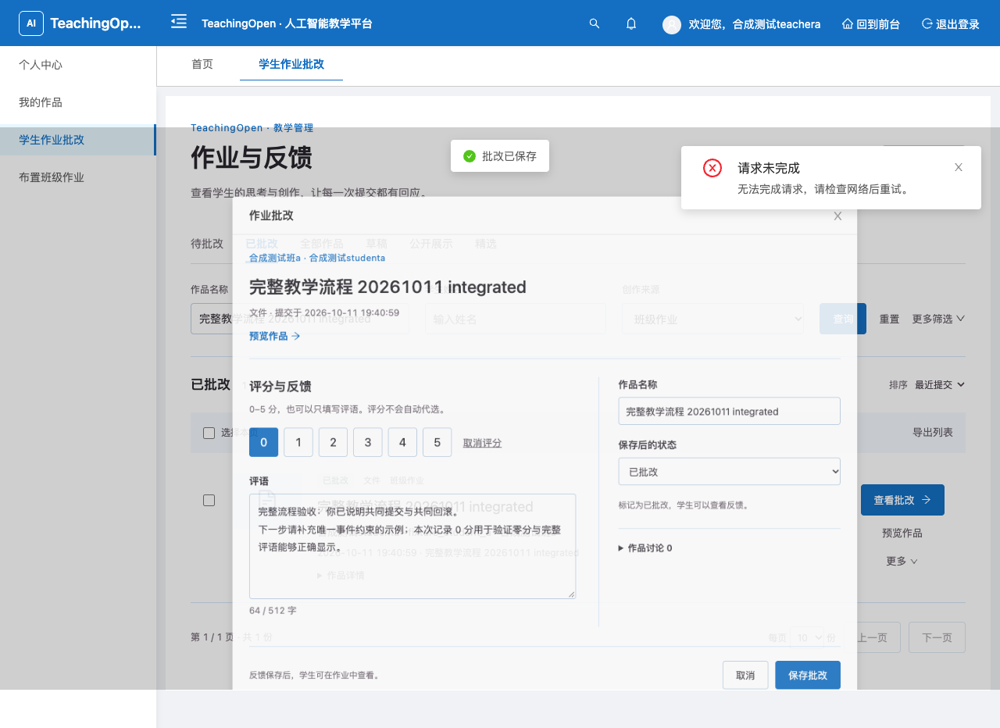
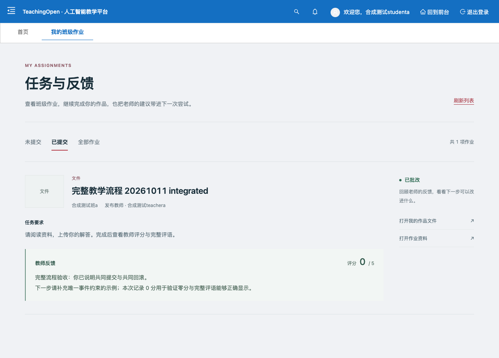
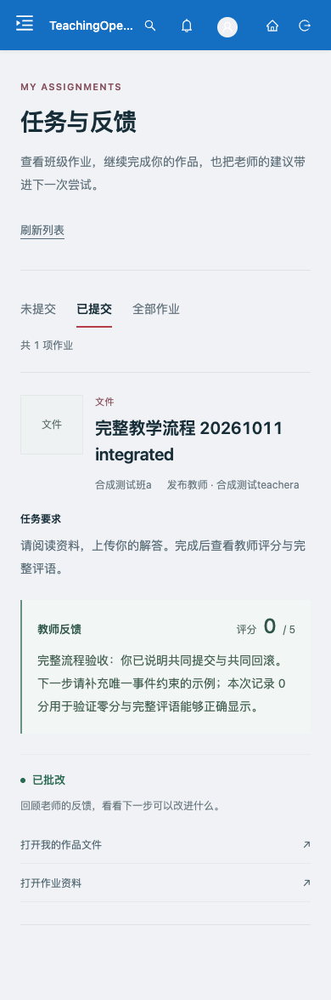

# 当前修复链的完整教学浏览器验收

范围：教师通过真实 SPA 布置文件作业，学生下载资料、上传并提交，教师预览作品并批改，学生查看反馈。仅使用五账号合成 MySQL/Redis 和本机 loopback；没有合并、部署或生产写入。#129 独立注册任务不在组合范围。

本次代码组合：#127 `eb4ef01c` 与 #133 `d2bc1cec`（含 #124–126、#128、#130–133）先形成 `c3ab0d67`，再由 `e2e88283` 修正两项 Java 夹具和两项文件删除 HTTP 夹具。随后复用另一任务的 #134 `728f6aae` 门禁，形成 `122dbf0f`；该合并不改变运行产品源码。随后复用 #134 `2dc7b63e` 的规则 SQL/机构夹具/路由与 POI 导出探针修正，整合为 `99d2d103`；仍无产品源码改动。当前验收 PR 只增加必要的夹具兼容、受保护的浏览器运行夹具与证据，不把上游业务实现重复计为本 PR 成果。

运行 JAR SHA-256：`bad79e7cf4917f6b056a153cae5bfb09c5a9219ae1fdcffa7f8c8af0891c02fb`。前端 dist 文件清单摘要：`93615d1651c6d0144321ed8bc28454d7c9293f882c950c4be8f7c43fe6556cc0`。详见 [运行记录](fixture-ready.json)、[浏览器结果](browser-result.json) 和 [最终数据库观察](browser-final-state.json)。最终组合流程期间这两个产物保持固定。

## 实际完成的流程

| 步骤 | 浏览器操作及落库核验 |
|---|---|
| 教师布置 | 填写作业名称、要求、文件类型、已发布和班级 A，真实上传 309 字节资料；保存失败时字段和附件保留、业务状态不变，重试后仅新增任务 `2109247511783841793`，编辑重开全部字段及资料地址一致 |
| 学生提交 | 班级 A 学生从列表打开任务、真实点击下载资料、上传 304 字节作品；提交失败时草稿和已上传文件保留，重试只生成作品 `2109247885542465538`，状态 1、SUBMIT 事件一条 |
| 教师批改 | 从待批改列表查询学生作品，打开预览并实际点击“打开作品文件”下载；保存 0 分和完整多行评语，首次请求中断后输入与业务状态不变，重试后状态 2、反馈一条、CORRECT 事件一条；“查看批改”重开内容一致 |
| 学生反馈 | 点击刷新，显示 0/5 和完整多行评语，已批改作业没有编辑入口；刷新中断显示错误及“重新加载”，不显示旧卡片；重试和整页重载后反馈一致 |
| 班级隔离 | 班级 B 学生与教师各自列表仍能看到自己的对象，却看不到本次流程对象；各自直接请求 4 个详情/反馈入口、尝试改分、下载教师资料和学生作品共 7 项均拒绝，业务、反馈、事件、统计、历史和媒体索引观察值完全不变 |
| 窄屏查看 | 浏览器缩为 390×844 后关闭侧栏并选择“已提交”，完整反馈可见；文档宽度 390、视口宽度 390。桌面到移动布局重建会回到默认筛选，本次没有把筛选跨布局持久化列为通过项 |

三项统计最终为布置 1、提交 1、批改 1。两次实际下载分别与原文件逐字节相同：教师资料 SHA-256 `b6bcbdaf3e09f316e26e70127e0719ad495681ceeab440d27ef936b87c443b52`；学生作品 SHA-256 `225d946223693052dfb584ee5b247c01e2e61a197341283037a0c84db8b409a5`。学生资料下载由学生 A 操作；作品下载由教师 A 在预览对话框点击真实链接，Playwright CLI 保存后由主 Agent 比较。仅打开预览链接本身不计为下载证明。

保存失败使用浏览器对下一次真实请求 `route.abort`，覆盖 UI 输入保留、错误提示和恢复，不等同于数据库提交后响应丢失。后端事务、并发和失败恢复另由 Java 与 HTTP 门禁核验。

## 整合中修复的验证阻塞

- 手工创建审计服务的 Java 测试缺少新索引依赖；编码引用下载测试没有建立索引来源。补入实际索引逻辑、事务和 H2 索引后，不再因夹具 NPE 中止，同时保留允许、拒绝与拒绝后索引不变断言。
- 两项文件删除 HTTP 夹具的直接 SQL 准备/清理需要同步派生索引，并把它加入恢复比对；实际 API 操作后不重建索引，不掩盖业务同步失败。
- 直接复用另一任务 #134 的 38 类 Java、26 组 HTTP 和菜单浏览器门禁，合并本分支媒体索引后为 39 类、27 组；保留 #134 将私有审计日志绑定 CI 自有进程的严格检查。本任务只补夹具接口/索引兼容和教学夹具安全测试，不重复实现该门禁。

[Java 结果](java-result.json)：39 类、354 项，零失败、错误、跳过。前端 `npm test` 853 项通过；生产构建、首屏资源预算和富文本运行依赖门禁通过。公告真实组件渲染、上传凭据真实 XHR 专项使用现有 Chromium headless shell 通过。本机 Google Chrome 和完整测试 Chromium 的 `--dump-dom` 曾超时，保留失败日志；CLI 教学流程使用其独立浏览器会话。

CI 离线守卫 47 项、教学夹具离线安全测试 12 项、媒体 SQL 计数分类离线测试 9 项通过。[27 组实际 HTTP/MySQL](http-result.json) 共 3,985 项全部通过，[下载专项](download-result.json) 88/88 通过；所有报告绑定同一 JAR。媒体索引采用 10/1,000/10,000 正文规模，共 128 项；CI 默认上限 1,000，数量另行记录。GitHub CI 结果另记录于 PR 描述并绑定最新提交，不使用旧分支绿灯替代新组合检查。

媒体索引原 95/96 失败确认是探针漏识别新的墓碑查询；修正后保留原 40/60 次 SELECT 和 0/40 扫描行限制，128/128 通过。规则 SQL 与导出 Excel 的初次失败由另一任务修正于 #134，本任务复用并分别重跑 91/91、389/389。原失败记录保留；初次规则清理失败遗留的一条合成记录，已按精确 ID、随机前缀和创建时间定向删除并另存恢复记录。

## 夹具与恢复

`api/dev/teaching-journey-fixture.py` 是本次已审核的本机专用夹具，固定到 `.devspace/media-index-1011`、端口 13391/16451/18191/18192、75 张已知表和五个合成账号。它只补 UI 路由、字典和班级元数据，不预造本轮作业、提交或反馈；登录通过真实验证码表单，不注入 token。素材端点仅接受本机 Host/Origin 和四个已知角色，不记录账号密码、验证码或令牌。

先独立启动同一候选后端，再运行：

```bash
python3 api/dev/teaching-journey-fixture.py \
  --runtime /Users/xuzihan/Documents/Projects/TeachingOpen/.devspace/media-index-1011 \
  --jar "$PWD/api/jeecg-boot-module-system/target/teaching-open-2.8.0.jar" \
  --dist "$PWD/web/dist" \
  --output /absolute/private/evidence-directory
```

不在另一个环境直接移除 guard。SIGINT/SIGTERM 会先关闭前端再恢复；SIGKILL 后只有同一 JAR 仍在运行且前端端口已释放时才使用相同参数加 `--restore`。快照不允许覆盖；schema、候选 JAR、原有文件或非目标业务表发生意外变化时停止自动恢复并保留私有备份。

[最终恢复记录](fixture-cleanup.json) 确认 17 张目标表、所选业务/UI 缓存与原有上传字节恢复，仅删除本轮两个上传文件。正常 `sys_log` 保留；正常登录会话和验证码按其既有 TTL 到期。浏览器完成后才开始串行接口探针，避免数据库夹具相互干扰。

## 证据边界与脚本诊断

完整命令日志、每阶段 CLI 脚本、原始截图及失败记录保存在本机 `.devspace/artifacts/teaching-journey-20261011`。仓库仅收录脱敏结果与代表截图，未收录认证材料、会话或配置。三个实现/调查子 Agent 分别负责夹具和 CI、流程与脚本、独立整合复核；主 Agent 执行最终真实浏览器和接口验证。子 Agent 请求配置均为 GPT-6.1 Sol ultra，主会话已见配置为 GPT-6 Astra ultra；请求参数不是对所有内部执行配置的额外证明。

最终学生提交、教师批改、学生反馈脚本均返回明确 `passed=true`。教师创建脚本首次遇已打开 modal 超时；第二次在文件选择器处 CLI 提前返回，异步流程继续完成保存，缺少完整 Result。其失败截图、唯一实际任务和后续独立重开核验补足行为证据，不能称整段创建脚本自动化门禁通过。脚本已改为原生文件 input，修改版仅静态检查，未重新创建任务。列表检查错误标签、隐藏 modal 定位和移动侧栏导致的前置超时保留为脚本诊断。

桌面反馈代表截图使用实际“已提交”视图；早期名为 `feedback-reloaded` 的截图截到了布局重建后的默认“未提交”列表，原图只保留为本机诊断，不作为反馈证明。重载反馈一致由第 04 步 Result 的 `reloaded=true` 和状态比较证明；`integrated-teacher-reopened.png` 是包含正确任务 ID 的列表截图，字段重开证据来自独立 Result。

浏览器控制台包含本地 CSP 拦截外部模板图标/旧错误上报脚本、主动注入的网络失败及预期 403；不声明零控制台错误。本次结果不代表整站无缺陷、真实师生试用、生产容量、部署或人工验收。




